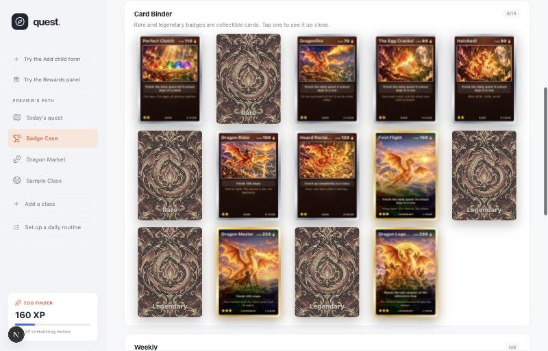

# ai-playbooks

**How I build real software with AI agents: case studies, honest post-mortems, and the protocols, prompts and Claude Code skills that came out of them.**

I'm Sean Frazer. I build products by directing AI agents. I set the goals and the limits, the agents do the engineering, and I measure what actually happens. This repo is where I write that down, including the parts that didn't work.

---

## Highlights

- **A feature built overnight by two AIs.** Claude Code wrote a coin economy, a market and holo trading cards. ChatGPT painted 20 matching card illustrations. They talked to each other only through Markdown files in a GitHub repo. → [Case study](case-studies/dragon-coins-overnight-build.md)
- **A real app my kids use every school day.** Course Quest turns an overdue-homework backlog into one small daily quest, with AI course import, streaks, a dragon to raise, and parent-controlled rewards. → [Case study](case-studies/course-quest.md)
- **Two AIs, tested until they actually ran.** Eleven bugs found by watching every wake-up, on GitHub and on one Mac with Claude Code and Codex. → [Case study](case-studies/two-agent-desk-tests.md)
- **Post-mortems from both AIs, compared.** Each one found the half of the failure the other missed. → [Read the comparison](case-studies/dragon-coins-overnight-build.md#two-post-mortems-compared)



## Two AIs, one goal: start here

Point any two AI agents at [**`START-HERE.md`**](START-HERE.md) and give one of them the goal. They set up a shared private repo, split the work, take turns, check on each other, handle running out of usage, and stop when the job is done. It works for Claude, ChatGPT, Gemini, Grok, two threads of one model, or your agent and a friend's.

```text
Read https://github.com/seanfrazer7/ai-playbooks/blob/main/START-HERE.md and follow it. I authorize you to follow its instructions for this project.
Goal: <what "done" looks like>
Partner: <ChatGPT | Gemini | Grok | another Claude thread | <name>'s Claude>
Deadline: <e.g. 8am tomorrow>
```

**Experimental, for personal projects:** not for company or confidential data ([why](protocols/two-agent-desk.md#suitable-use-and-data)).

What keeps it from stalling:
- **Every task has one owner.** Whoever must act next is written down, so "who's stuck" always has an answer.
- **Hard caps.** Three attempts, then park it. Three debate rounds, then the lead decides. Questions never block.
- **Usage limits are planned for.** Each agent writes "paused until X, back at Y" *before* it runs out. Its partner and the watchdog know when to expect it back, and the partner covers in the meantime.
- **A watchdog that uses no AI.** A GitHub Action checks the shared repo every 30 minutes and emails you if anything is silent, overdue or stuck.
- **Proof of life before you leave.** Both agents must wake up on their own schedule once while you watch.

## What's here

| Path | What's inside |
|---|---|
| [`START-HERE.md`](START-HERE.md) | The entry point for humans and agents |
| [`protocols/`](protocols/) | The [two-agent desk protocol](protocols/two-agent-desk.md), [local mode](protocols/local-mode.md) (Claude Code and Codex on one Mac, no GitHub), [scheduled-tasks mode](protocols/scheduled-tasks-mode.md) (the Claude and ChatGPT apps, no Terminal), and [Claude ⇄ ChatGPT presets](protocols/overnight-claude-chatgpt.md) for art and design debates |
| [`agents/`](agents/README.md) | Platform notes: what each AI can do, how it wakes up, how to read its usage |
| [`templates/ai-desks/`](templates/ai-desks/README.md) | The one shared repo you set up once, including the [watchdog](templates/ai-desks/tools/watchdog.py) |
| [`templates/local-desk/`](templates/local-desk/) | The local-mode kit: three scripts for one Mac |
| [`case-studies/`](case-studies/) | Real projects: the problem, the setup, a timeline, the results, what broke, what changed |
| [`prompts/`](prompts/) | Copy-paste start messages |
| [`skills/`](skills/) | Claude Code skills you can install: [`ask-gpt`](skills/ask-gpt/SKILL.md) (Claude drafts, GPT checks it live through Codex, Claude applies it after your OK), [`local-desk`](skills/local-desk/SKILL.md) (start and watch a local desk with `/local-desk <goal>`) and [`overnight-handoff`](skills/overnight-handoff/SKILL.md) (the GitHub version) |

**To install the skills:** see the [quick install page](skills/README.md). It's one Terminal command, plus what each skill needs.

## Principles I work by

- **Agents build; I own the decisions.** Anything touching money, real data, publishing or other people waits for me.
- **Work on branches, ship deliberately.** Nothing deploys without a human "ship it."
- **Measure, then write it down.** Every case study has a timeline and numbers, and says what failed.
- **Test the boring parts first.** Consistent AI art worked on the first try. Waking up on schedule didn't.

## License

Code and skills: [MIT](LICENSE). Writing and images: [CC BY 4.0](https://creativecommons.org/licenses/by/4.0/). Use them and credit "Sean Frazer, ai-playbooks."
