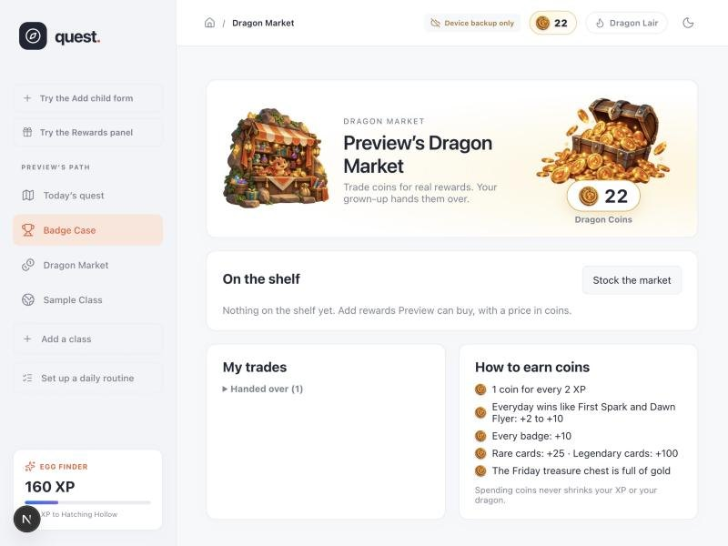
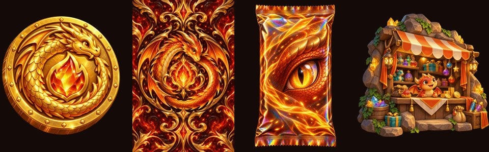

# Course Quest

**A gamified homework catch-up planner I built for my kids, mostly by directing AI coding agents.**

My kids had fallen behind in online school. The school's portal showed a wall of overdue assignments, and nobody wanted to look at it. Course Quest turns that wall into one small daily quest, and rewards finishing it.

> The source is private because it's my family's live app. This page describes it; the screenshots come from the app's demo mode, which has no real data.

## What it does

- **Import a class from the school's report.** A parent uploads a PDF or screenshot of the progress report. An AI model reads it, builds the course (units, lessons, due dates and time estimates), and the parent reviews it before saving.
- **A catch-up plan.** The parent picks a target date. The app spreads the overdue work across the school days before it, so each day is a short, doable quest.
- **Daily routines** for subjects that are "one lesson a day" rather than "catch up on a backlog."
- **Kid devices.** A parent pairs a kid's tablet with a short code. Kids see their own quest and can't change parent settings.
- **Gamification that kids actually respond to:**
  - **Quest themes.** Kids can switch to *Dragon Keeper*: an egg that glows, cracks, hatches and grows over about 8 weeks of steady work, with full-screen celebrations at each stage.
  - **Streaks**, a **Friday treasure chest** (finish 4 of 5 days to open it; parents set the prizes), and **badges** in three rarities.
  - **Dragon Coins** and a **Dragon Market** where kids trade coins for rewards their parents stock.
  - **Rare and legendary badges as holo trading cards** with a pack-opening reveal. (Built overnight by two AIs; see [that case study](dragon-coins-overnight-build.md).)

## Stack

Next.js (App Router) · React · TypeScript · Supabase (Postgres with row-level security) · Netlify · Anthropic API for course import · ChatGPT image generation for the art.

## Technical decisions I'd point to

- **Progress is derived, not stored as totals.** XP, coin balances, streaks and badges are all calculated from the raw record of what the kid finished. A reload can't double-pay coins, and fixing a mistake (unchecking a step) fixes everything downstream automatically.
- **Two devices at once.** A kid on a tablet and a parent on a laptop can both make changes. When saves collide, the app does a three-way merge, replaying this device's changes on top of the newer cloud copy, instead of throwing work away.
- **Parents' settings live where kids can't write them.** Reward lists, chest prizes and market prices are only editable from the parent side, enforced by the database, not just hidden in the interface.
- **Every feature has a demo mode** (`?preview=1`) with fake data. It's how the AI agents test their own work in a real browser before I see it.
- **Paid deploys are deliberate.** Hosting deploys cost credits, so all work goes to branches, gets built and checked locally, and is batched into one release I approve.

## How it gets built

I act as the product owner and the AIs act as the engineers. I describe what the kids need ("the badges feel meaningless," "red notification bubbles stress them out"). Claude Code designs it, builds it, tests it in the browser, and pushes to a branch. I review it and say "ship it." For art, ChatGPT generates images from a written style guide, and Claude processes them and wires them in.

The process itself is written up as a reusable protocol: [protocols/overnight-claude-chatgpt.md](../protocols/overnight-claude-chatgpt.md).
