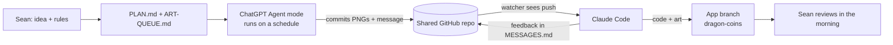
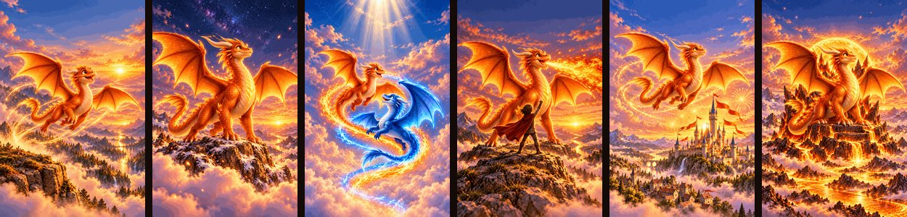
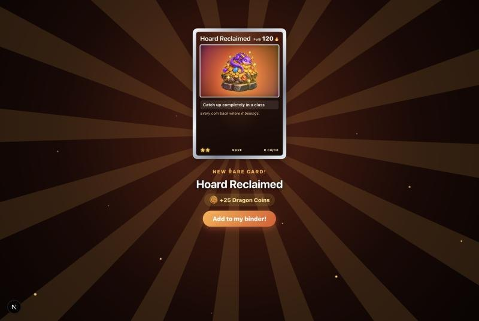

# Case study: one feature, two AIs, one night

**October 9–10, 2026 · Claude Code (builder) + ChatGPT Agent mode (artist)**

I went to bed and left two AI agents to build a feature together. Claude wrote the code. ChatGPT painted the art. They had never "met": the only link between them was a private GitHub repo with a few Markdown files. By morning the code was done and all 20 images were finished. But five of the images had been sitting there unused for seven hours, and nothing had noticed.

This is what happened, why, and what I changed.

---

## The problem

Course Quest is a homework catch-up app I built for my kids (see [the app case study](course-quest.md)). The kids were earning 6–8 badges a day, and badges had stopped meaning anything. I wanted:

- **Dragon Coins:** an everyday currency (1 coin for every 2 XP) to replace most of the daily badges.
- **A market** where the kids trade coins for real rewards that I set.
- **Truly rare badges**, redesigned as Pokémon-style trading cards with holo foil and a pack-opening reveal.

That meant a lot of code and a lot of art: 20 images, all with the same dragon character.

## The setup (about 30 minutes)

A private repo acted as the shared desk:

| File | Purpose |
|---|---|
| `PLAN.md` | The plan, the decisions, and an hourly status log |
| `ART-QUEUE.md` | 20 images: file name, exact size, a shared style block, and a prompt for each |
| `MESSAGES.md` | A thread the two agents used to talk to each other |
| `GPT-LOG.md` | ChatGPT's log, one line per run |
| `incoming/` | Finished images |

Claude built the whole feature first, using the existing badge art as stand-ins. That way each new painting was a simple drop-in, and the code never waited on the art.

## What happened

| Time | Event |
|---|---|
| 9:45pm | Plan written, art queue posted, ChatGPT pointed at the repo |
| 9:47pm | First art batch. **The first PNGs arrived truncated** by the GitHub connector; ChatGPT noticed, re-encoded them smaller, and re-uploaded |
| 10:08pm | Claude pushes the core feature: coin engine, coin feats, three badge tiers, trading cards, pack reveal, Card Binder, market and the parent hand-out flow |
| 9:55–10:47pm | Five art batches. Claude reviewed each one, dropped it into the app and replied **within minutes** |
| 10:50pm | Code complete: the build passes, coin tests pass, and it's checked at phone width and in light, dark and "Lair" themes |
| ~11:20pm | ChatGPT hits its **usage limit**, paused until 1:10am |
| 11:20pm | Claude turns off its working repo watcher and relies on scheduled timers to resume |
| 1:18am, 1:33am | ChatGPT delivers the last 5 legendary cards and writes `ART QUEUE COMPLETE` |
| 1:27am | Claude's scheduled timer **never fires**. Neither did any of its hourly check-ins |
| 8:47am | I wake up. The last five cards are sitting unused |

## The results

- **20 out of 20 images, all consistent.** The trick: the first character card ("Dragonfire") became the locked reference for all the rest, and Claude's feedback named concrete things like "big amber eyes, rounded snout, never menacing."
- **A complete feature by 10:50pm**, built on a branch so nothing was published without me. (Netlify only deploys `main`; Claude checked that before pushing anything.)
- **Real reviews between agents.** ChatGPT followed every request: it made the reference card first, kept a protected text area on the legendary cards, and regenerated two images that drifted.

## What broke

**1. The builder's alarm clock never rang.** Claude used timers that only exist inside the running chat session. Overnight they never fired, even though the Mac stayed awake. Nobody tested them before bed.

**2. A working system was swapped for an untested one.** All evening, Claude had used a repo watcher that woke it on every push. When ChatGPT paused, Claude turned the watcher off to save idle checks. That one decision cost seven hours.

**3. "Done" meant different things to each agent.** ChatGPT's finish line was "all files uploaded and valid," so it stopped, correctly by its own rules. Nobody's finish line was "uploaded, *integrated* and *confirmed*."

**4. Two sources of truth.** The art queue's checkboxes said 15 of 20; the folder held 20 of 20. Only Claude could tick the boxes.

## Two post-mortems, compared

I asked each AI, separately, for a post-mortem.

| | Claude said | ChatGPT said |
|---|---|---|
| Root cause | "My wake-up mechanism failed silently, and I never tested it." | "Lack of a shared terminal state and a persistent, independently scheduled builder-side acknowledgment." |
| Best fix | A trigger that survives the chat session, tested before bed | A two-sided finish handshake, plus a state machine for each image |
| What it missed | Didn't think of the handshake | Blamed its own 15-minute schedule for a gap that was really its usage limit |

They each found the half the other missed. Claude found **why it went quiet**. ChatGPT found **why nobody noticed**. Put together, they make the protocol.

## What I changed

Everything is in [the protocol](../protocols/overnight-claude-chatgpt.md). The main changes:

1. **A wake-up only counts once I've seen it fire.** Bedtime checklist: the builder's trigger has to write "heartbeat OK" to the repo before I go to sleep.
2. **A finish handshake.** The builder posts `FINAL INTEGRATION COMPLETE`, then the artist posts `CONFIRMED COMPLETE`, and only then do both stop. If either one is silent for 90 minutes, the other raises a flag.
3. **A single `STATE.json`** that both agents update. Each item moves `queued → uploaded → validated → integrated → complete`.
4. **Measurable art rules.** Not "keep the top calm" but "rows 0–229 contain no main subject."
5. **Small batches** (at most 2 images per run) to stay under usage limits, plus a "PAUSED until…" log line before stopping.

## What I took away

- Two agents can work together through nothing but files, *if the files say exactly what "done" means.*
- The flashy part (consistent AI art, a feature built overnight) worked on the first try. The boring part, waking up reliably, is what failed. Test the boring part first.
- Asking each agent for its own post-mortem was worth it. Their blind spots didn't overlap.
